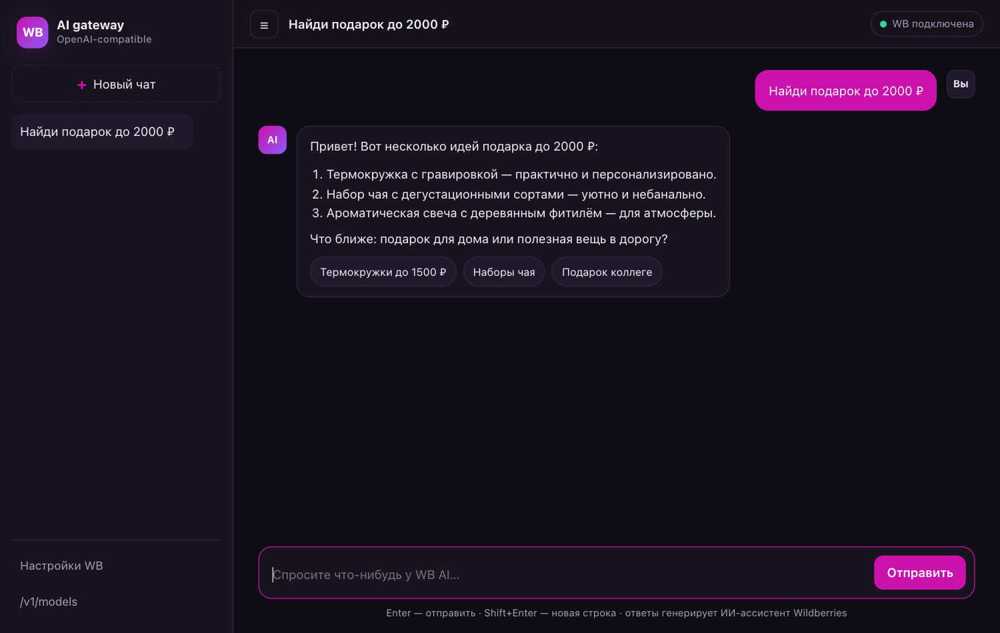

# WB AI → OpenAI-compatible gateway

[](https://github.com/NovaStream2030/wildberries-ai/actions/workflows/ci.yml)
[](LICENSE)

Локальный шлюз к ИИ-ассистенту Wildberries с OpenAI-совместимым API и
простым веб-чатом. Работает на Bun, без runtime-зависимостей.



<p align="center"><sub>Скриншот с демонстрационным ответом (локальный фейковый upstream).</sub></p>

> **Неофициальный проект.** Не связан с Wildberries. Шлюз использует тот же
> приватный endpoint, что и веб-клиент WB; он может измениться или быть
> закрыт в любой момент. Условия Wildberries могут запрещать автоматические
> запросы. Используйте на свой риск, не перегружайте сервис и не публикуйте
> его в интернет.

## Возможности

- `POST /v1/chat/completions` — OpenAI Chat Completions, stream и non-stream.
- `POST /v1/completions` — legacy completions.
- `GET /v1/models` — `wb-assistant` и `wb`.
- Потоковый веб-чат: стриминг, «Стоп», подсказки WB, история, настройки.
- Соответствие stateless OpenAI ↔ stateful WB-сессий с автоматическим
  восстановлением.
- `WB_PROMPT_MODE=auto` отбрасывает огромные system prompts кодинг-агентов,
  чтобы WB не считал запрос офтопом.
- Сессия WB хранится вне репозитория, файл `0600`; браузерный CORS ограничен.

## Быстрый старт

Нужен [Bun](https://bun.sh) 1.1+.

```bash
git clone https://github.com/NovaStream2030/wildberries-ai.git
cd wildberries-ai
bun install
bun start
# http://127.0.0.1:8787
```

`bun install` нужен только для dev-типов; сам сервер работает без
зависимостей. Для разработки: `bun run dev`.

## Подключение сессии WB

Ассистент включён только для авторизованных пользователей. В клиентском коде
WB это видно явно:

```js
isEnabled() {
  const { isAuth } = this.authService;
  if (!isAuth) return false;
  ...
}
```

Без живой сессии `ai-proxy` отвечает `HTTP 401` с пустым телом и заголовком
`status-no-id` (например `PG-0305-EL`).

1. Войдите на [wildberries.ru](https://www.wildberries.ru/) в Chrome.
2. Откройте ИИ-ассистента и отправьте любое сообщение.
3. DevTools → Network → запрос `chat/v5/message`.
4. Скопируйте из Request Headers:
   - `authorization` без `Bearer` → поле **JWT**;
   - `x-userdata` → поле **x-userdata (uv)**;
   - `cookie` — если сервер требует cookie.
5. Вставьте в «Настройки WB» и нажмите «Проверить».

В настройках есть сниппет для Console: он перехватит следующий запрос
ассистента и скопирует `{jwt, userData, userMetadata}` в буфер. `cookie` в JS
недоступен, если он `httpOnly`; при необходимости скопируйте его из DevTools.

JWT живёт ограниченное время. При `wb_unauthorized` повторите захват.

## OpenAI API

```bash
curl -s http://127.0.0.1:8787/v1/chat/completions \
  -H 'content-type: application/json' \
  -d '{
    "model": "wb-assistant",
    "messages": [{"role": "user", "content": "Найди подарок до 2000 ₽"}]
  }'
```

```bash
curl -N http://127.0.0.1:8787/v1/chat/completions \
  -H 'content-type: application/json' \
  -d '{
    "model": "wb-assistant",
    "stream": true,
    "messages": [{"role": "user", "content": "привет"}]
  }'
```

```python
from openai import OpenAI

client = OpenAI(base_url="http://127.0.0.1:8787/v1", api_key="not-needed")

stream = client.chat.completions.create(
    model="wb-assistant",
    messages=[{"role": "user", "content": "Что сейчас в тренде?"}],
    stream=True,
)
for chunk in stream:
    print(chunk.choices[0].delta.content or "", end="")
```

Любое имя модели принимается и повторяется в ответе; upstream всегда WB.
Поддерживаются `messages` с ролями `system`/`user`/`assistant`, `content`
строкой или массивом текстовых частей, `stream` и
`stream_options.include_usage`.
`n>1` и изображения отклоняются. `temperature`, `top_p`, `max_tokens`,
`stop`, `tools`, `response_format` принимаются, но WB их не использует.

`usage` считается приблизительно (4 символа ≈ 1 токен): upstream не отдаёт
токены.

## Tool calling

Надёжного `tools`/function calling нет: WB — закрытый shopping-ассистент, а не
general-purpose модель. `tools` принимаются и игнорируются, ответ приходит
обычным текстом.

Проверяли на живом upstream:

| Сценарий | Результат |
|---|---|
| `tool_choice`-подобная явная инструкция в user-сообщении: `calculate` / `search_products` | WB вернул точный JSON `{"tool_call":…}` |
| Автовыбор инструмента на приветствии/обычном запросе | `moderation_blocked`, `error 9000` или нативный product search вместо JSON |
| Кодинг-инструменты (`read_file`, `bash`, `edit`) | `moderation_blocked` |

Поэтому «виртуальный tool calling» через промпт был бы демо, а не
OpenAI-совместимой функцией. Честный путь для агентов — гибридный роутер:
настоящая LLM выбирает инструменты, WB отвечает только за shopping-запросы.
Это отдельный проект; здесь шлюз остаётся чат-моделью.

## Как это работает

OpenAI stateless: клиент присылает всю историю. WB stateful: у него есть
`session_id`, а в запросе передаётся только новый текст.

1. Шлюз хэширует историю до последнего сообщения пользователя (включая
   `system`) в ключ разговора.
2. Если для ключа есть `session_id`, отправляется только новый текст с
   `session_id`.
3. Если нет — `system` + история склеиваются в один `text` и создаётся новая
   WB-сессия. В режиме `auto` слишком длинный текст заменяется последним
   сообщением пользователя.
4. После ответа `session_id` запоминается под ключом истории *после* ответа.
5. При `404/410` от WB шлюз один раз повторяет запрос со всей историей.

Сессии живут 6 часов в памяти. После рестарта клиент начнёт новую WB-сессию с
полной историей (или с последним сообщением в `auto`).

### Формат upstream

`POST https://ai-proxy.wildberries.ru/ai-proxy/api/chat/v5/message`

Заголовки: `accept: text/event-stream`, `x-client: web`,
`x-accept-markdown: true`, `x-userdata: <uv>`, `authorization: Bearer <jwt>`,
`origin`/`referer` wildberries.ru.

Тело:

```json
{
  "session_id": "…",
  "timestamp": "2026-11-18T08:07:20.297Z",
  "text": "привет",
  "user_metadata": {
    "appType": "1", "curr": "rub", "dest": "1259570991",
    "spp": "30", "uv": "<uv>", "uiv": "0",
    "device_id": "site_…", "locale": "ru", "lang": "ru"
  },
  "features": {
    "snippets": {"supported_types": ["products_base", "product_button_to_checkout", "products_fav_base", "products_purchases_base", "products_orders_base", "products_you_watched_base", "products_basket_base", "hotels_base"]},
    "products": {"supported_types": ["goods", "hotels"]},
    "flags": {"multi_products": true}
  },
  "client_data": {"platform": "web", "mode": "browser"},
  "idempotency_key": "uuid"
}
```

Ответ — SSE: `start` (`session_id`), `chunk` с `type: text` (`block_position`,
`text`), `chunk` с `suggests`, `done` (`scenario_info`). Шлюз транслирует
текстовые чанки в OpenAI-дельты, а `suggests`, `session_id` и `state` кладёт
в необязательное поле `wb` финального чанка/ответа. Остальные типы событий
пропускаются. `state: ignored` вместе с текстом — нормальное завершение
(офтоп/отказ), а не ошибка.

## Эндпоинты

| Метод | Путь | Назначение |
|---|---|---|
| GET | `/` | веб-чат |
| GET | `/health` | статус и наличие сессии |
| GET | `/api/config` | публичные флаги настроек |
| POST | `/api/config` | сохранить JWT / `x-userdata` / cookie |
| POST | `/api/config/test` | тестовый запрос к WB |
| POST | `/api/sessions/reset` | очистить кэш WB-сессий |
| GET | `/v1/models` | список моделей |
| POST | `/v1/chat/completions` | OpenAI Chat Completions |
| POST | `/v1/completions` | OpenAI Completions |

## Конфигурация

Значения из env перекрывают файл.

| Переменная | По умолчанию | Назначение |
|---|---|---|
| `HOST` | `127.0.0.1` | адрес прослушивания |
| `PORT` | `8787` | порт |
| `WB_DATA_FILE` | `$XDG_CONFIG_HOME/wildberries-ai/session.json` | файл сессии; legacy `data/session.json` читается, если нового нет |
| `WB_JWT` | — | bearer JWT |
| `WB_USER_DATA` | — | `x-userdata` |
| `WB_COOKIE` | — | cookie |
| `WB_USER_METADATA` | — | JSON-объект `user_metadata` |
| `WB_UPSTREAM_URL` | endpoint WB | для тестов/зеркал; получает ваши креды |
| `ADMIN_TOKEN` | — | bearer-токен для всех записей настроек |
| `ALLOWED_ORIGINS` | — | дополнительные Origin через запятую; без `*` |
| `WB_REQUEST_TIMEOUT_MS` | `120000` | таймаут запроса |
| `WB_IDLE_TIMEOUT_MS` | `90000` | таймаут простоя стрима |
| `WB_SESSION_TTL_MS` | `21600000` | TTL сессий |
| `WB_MAX_SESSIONS` | `2000` | размер кэша сессий |
| `WB_PROMPT_MODE` | `auto` | `auto`/`inline`/`last` |
| `WB_MAX_INLINE_CHARS` | `4000` | порог `auto` |

## Безопасность и приватность

- По умолчанию только `127.0.0.1`.
- Креды — в `~/.config/wildberries-ai/session.json` (`0600`), не в репозитории.
  Legacy `data/session.json` git-ignored.
- CORS разрешён только для собственных localhost-origin и явных
  `ALLOWED_ORIGINS`; wildcard `*` не используется. CSP, `X-Frame-Options:
  DENY`, `nosniff`.
- POST с чужим `Origin` отклоняется до CORS, поэтому cross-site form/fetch
  не может дёрнуть API. Тело должно быть `application/json`.
- Тело запроса ограничено 2 MiB.
- Если открываете UI по LAN-адресу, добавьте его origin в `ALLOWED_ORIGINS`,
  иначе браузерные записи настроек будут отклонены.
- Запись настроек — только с loopback. Если задан `ADMIN_TOKEN`, он требуется
  для каждой записи, в том числе с loopback (reverse proxy делает удалённых
  клиентов «локальными»). В UI есть поле Admin token.
- Шлюз действует от вашей WB-сессии: не выставляйте его в интернет. См.
  [SECURITY.md](SECURITY.md).

## Ограничения

- Приватный WB endpoint может измениться; это не официальный API.
- Нет структурированных товарных карточек: в ответах WB — текст и `suggests`.
- Нет надёжного `tools`/function calling; в агентских клиентах модель
  работает как обычный чат.
- JWT и `x-userdata` обновляются вручную.
- Токены `usage` приблизительные.
- Стрим WB может содержать неизвестные типы событий; они пропускаются.

## Разработка

```bash
bun run check   # tsc --noEmit && bun test
```

29 тестов на фейковом WB SSE-сервере: промпты, сессии, OpenAI-схема,
streaming, `session_id`, `state: ignored`, 401/503, CORS, лимит тела,
`ADMIN_TOKEN`, `/v1/models`, `/api/config`, UI. Реальный WB в тестах не
вызывается.

```
src/config.ts     конфигурация и хранение сессии
src/prompt.ts     промпт, транскрипт, ключи и кэш WB-сессий
src/wb.ts         upstream-клиент, SSE-парсер, ошибки
src/openai.ts     OpenAI-схемы, streaming, completions
src/server.ts     HTTP-роуты, статика, настройки, CORS
public/           веб-чат
test/             bun:test
```

## Лицензия

[MIT](LICENSE). Проект не связан с Wildberries.
